# lm-eval translator KV PCA

**Completed frozen analysis. No KV tensors saved.**

Original validation-selected lm-eval retrained checkpoints; exact original harness prompts.
Eight calibration and24 disjoint analysis documents per task. MCQ and GSM8K are independent.
PCA is fitted to native calibration vectors per layer/head. All arms use the same center and axes.
Plots use KV head0 at prespecified layers1/12/24/36; full36x8 metrics are retained.

Task scores below reuse original official lm-eval outputs on the same selected documents.
Fixed-Q attention probes isolate memory changes; actual cache-injection output KL is reported separately.

## mcq

Calibration: 16 prompts / 255 tokens. Analysis: 48 prompts / 761 sampled tokens.

| KV | Arm | Paired NMSE | Cosine | Variance/native | CKA | Outside native90% subspace |
|---|---|---:|---:|---:|---:|---:|
| K | Stage A | 0.1270 | 0.9343 | 0.6103 | 0.8452 | 0.1028 |
| K | Stage A+B | 0.1340 | 0.9310 | 0.6118 | 0.8450 | 0.1268 |
| V | Stage A | 0.7642 | 0.7304 | 1.0893 | 0.7409 | 0.1884 |
| V | Stage A+B | 0.7695 | 0.7259 | 1.0891 | 0.7404 | 0.1947 |

| Arm | Actual first-token output KL | First argmax agrees |
|---|---:|---:|
| Stage A | 1.768400 | 52.1% |
| Stage A+B | 0.782917 | 64.6% |

Native reconstruction numerical floor KL: 0.00003159.

Original official scores on selected analysis documents:
```json
{
  "openbookqa": {
    "native": {
      "acc": 0.2916666666666667,
      "acc_norm": 0.4166666666666667
    },
    "stage_a": {
      "acc": 0.25,
      "acc_norm": 0.375
    },
    "stage_b": {
      "acc": 0.375,
      "acc_norm": 0.375
    }
  },
  "arc_challenge": {
    "native": {
      "acc": 0.5416666666666666,
      "acc_norm": 0.5833333333333334
    },
    "stage_a": {
      "acc": 0.25,
      "acc_norm": 0.3333333333333333
    },
    "stage_b": {
      "acc": 0.5,
      "acc_norm": 0.5416666666666666
    }
  }
}
```

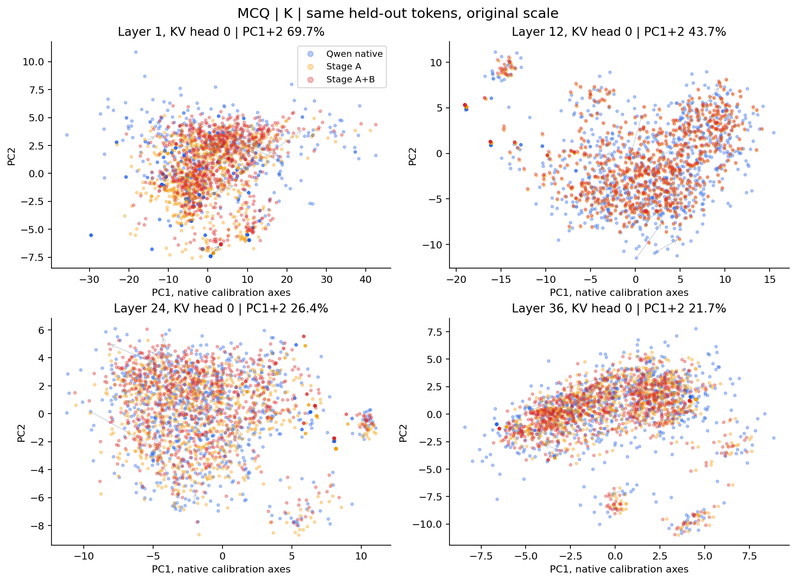

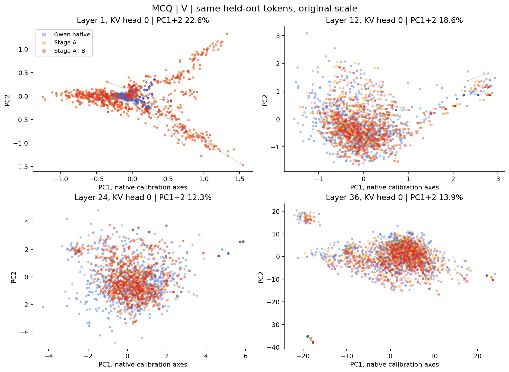

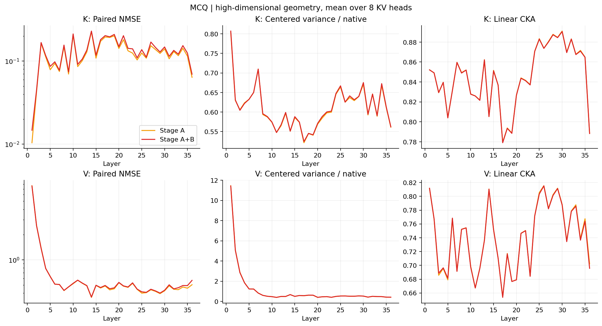

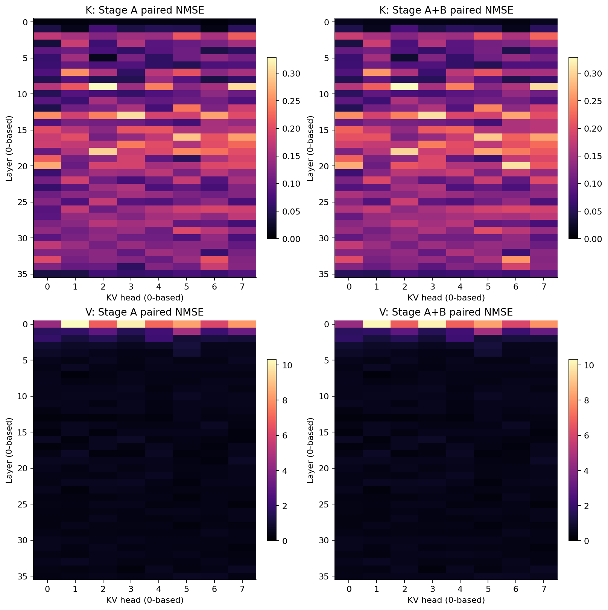

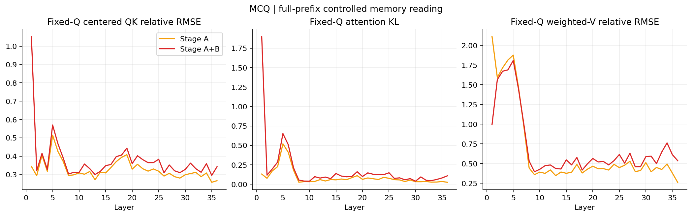

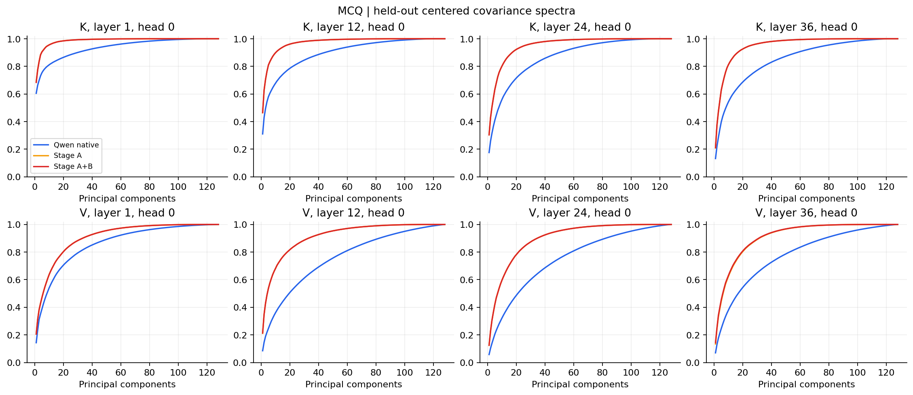

## gsm8k

Calibration: 8 prompts / 256 tokens. Analysis: 24 prompts / 768 sampled tokens.

| KV | Arm | Paired NMSE | Cosine | Variance/native | CKA | Outside native90% subspace |
|---|---|---:|---:|---:|---:|---:|
| K | Stage A | 0.1308 | 0.9313 | 0.6332 | 0.8335 | 0.0888 |
| K | Stage A+B | 0.1401 | 0.9266 | 0.6372 | 0.8331 | 0.1161 |
| V | Stage A | 0.4746 | 0.7805 | 0.7206 | 0.7509 | 0.1732 |
| V | Stage A+B | 0.4830 | 0.7747 | 0.7207 | 0.7500 | 0.1790 |

| Arm | Actual first-token output KL | First argmax agrees |
|---|---:|---:|
| Stage A | 3.741037 | 50.0% |
| Stage A+B | 0.442655 | 75.0% |

Native reconstruction numerical floor KL: 0.00006013.

Original official scores on selected analysis documents:
```json
{
  "gsm8k": {
    "native": {
      "exact_match": 0.9166666666666666,
      "flexible_exact_match": 0.875
    },
    "stage_a": {
      "exact_match": 0.0,
      "flexible_exact_match": 0.041666666666666664
    },
    "stage_b": {
      "exact_match": 0.5833333333333334,
      "flexible_exact_match": 0.5833333333333334
    }
  }
}
```

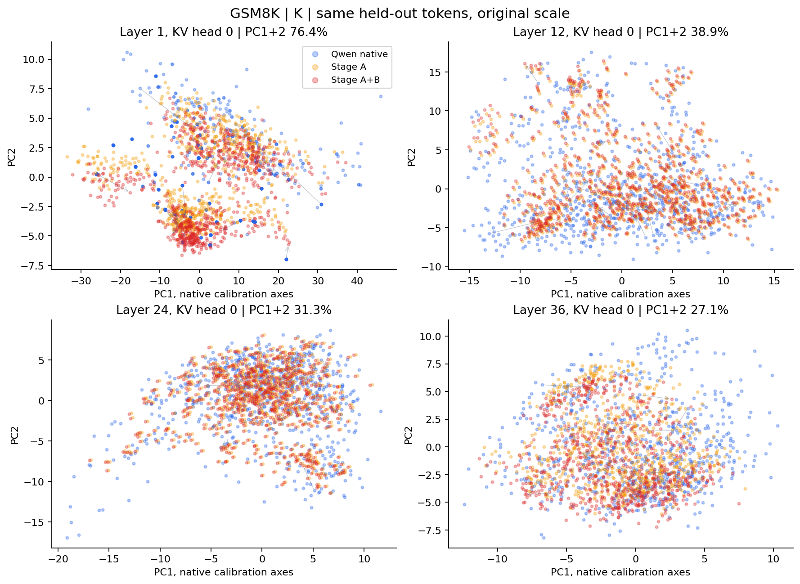

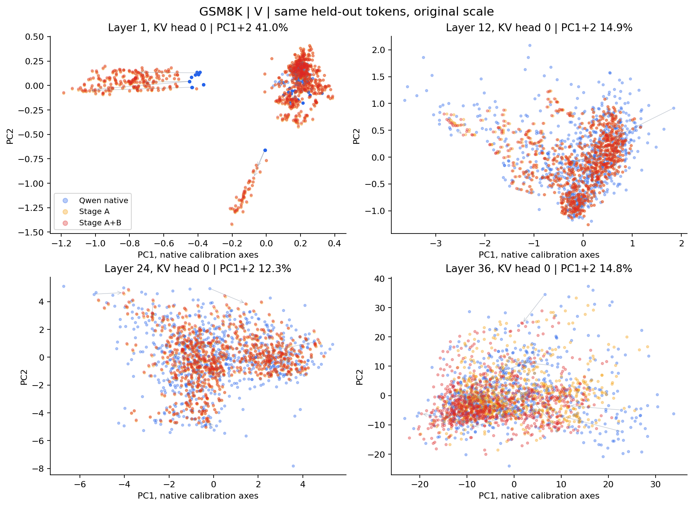

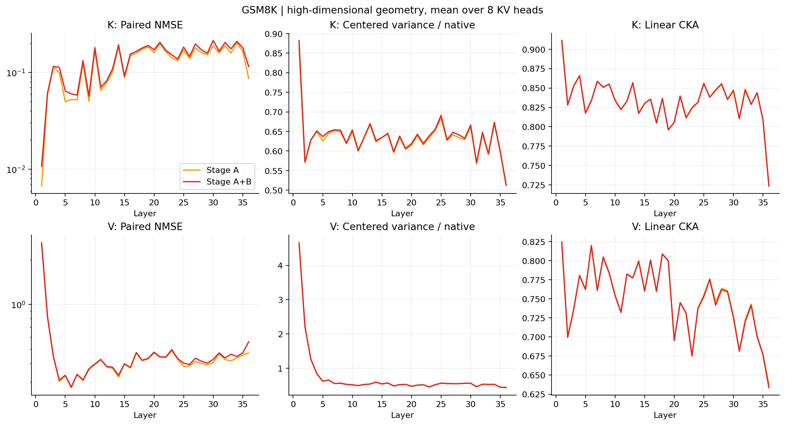

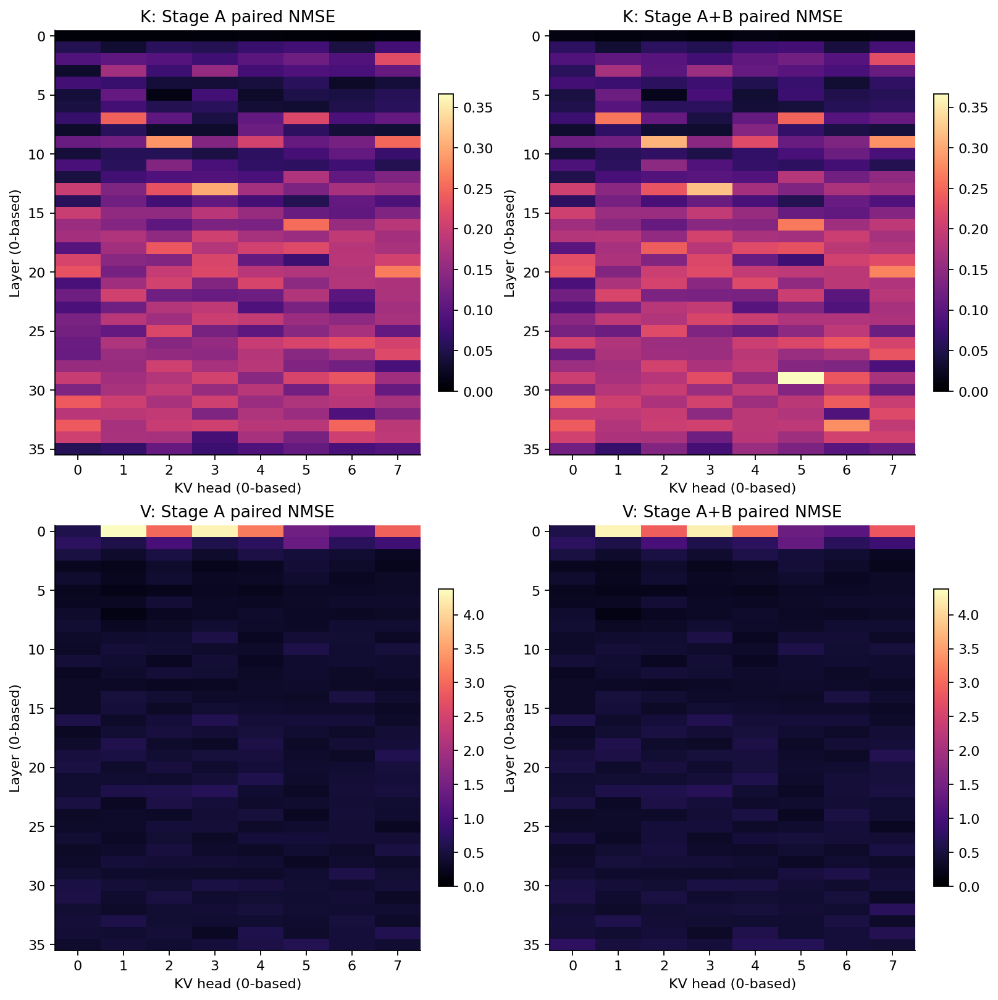

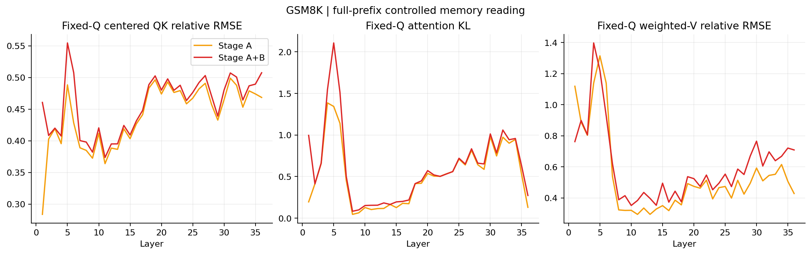

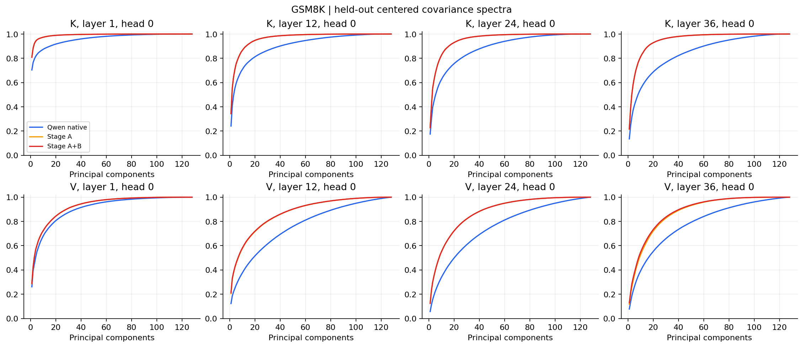

## Interpretation limits

- PC1+PC2 explained variance is shown in every panel;2D overlap does not establish full-space alignment.
- Native90% subspace excludes some native held-out energy too; compare to the native baseline in raw metrics.
- CKA is insensitive to isotropic scaling and does not establish direct cache compatibility.
- Positions are sampled uniformly within prompts; GSM8K includes few-shot demonstration tokens.
- MCQ aggregates two task distributions; token metadata retains task and position for stratified inspection.
- PCA calibration uses a disjoint subset of official evaluation documents, without model fitting or checkpoint tuning.
- Receiver query trajectories can change after injection; fixed-native-Q probes are a controlled diagnostic.
- No mixed-source composition or receiver adaptation is tested here.

Raw metrics: metrics/*_layer_head.json and metrics/*_summary.json. Paired2D coordinates and token identities: metrics/*_projection_points.json.
