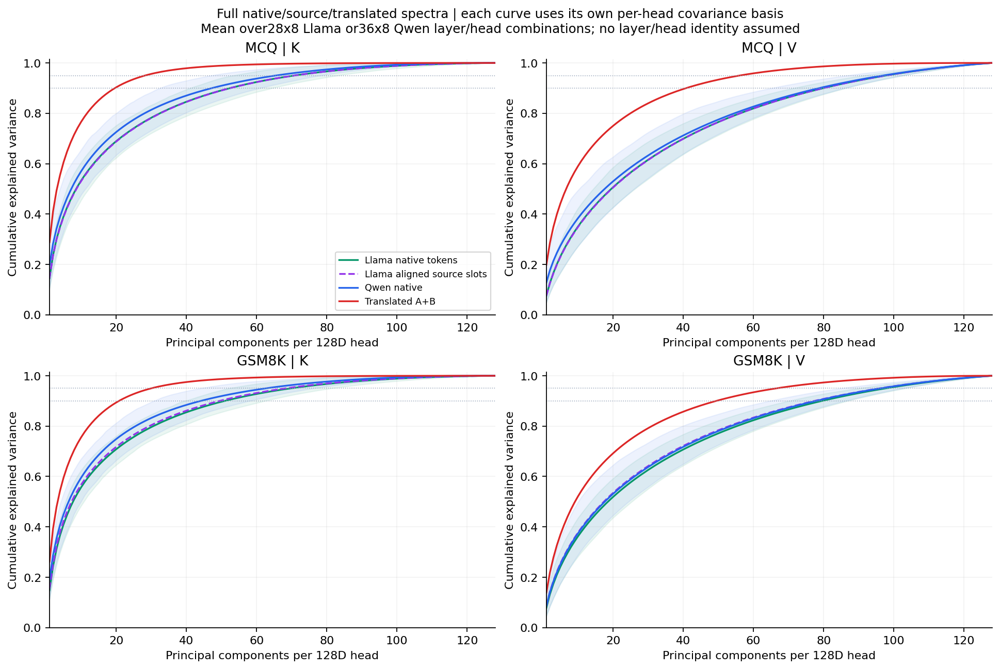
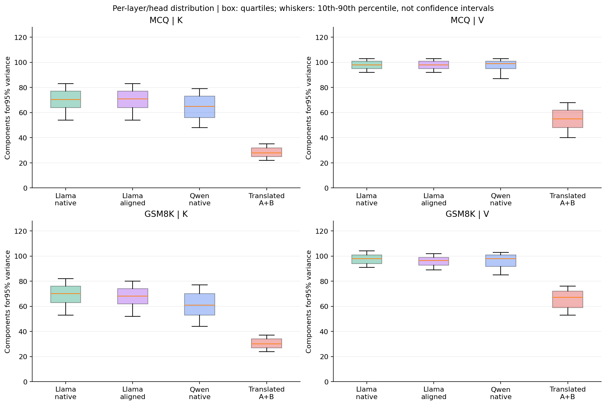
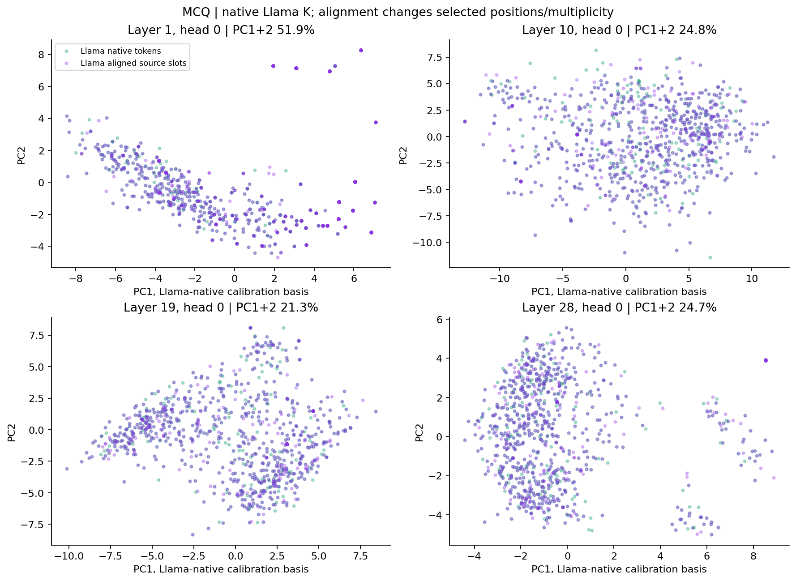
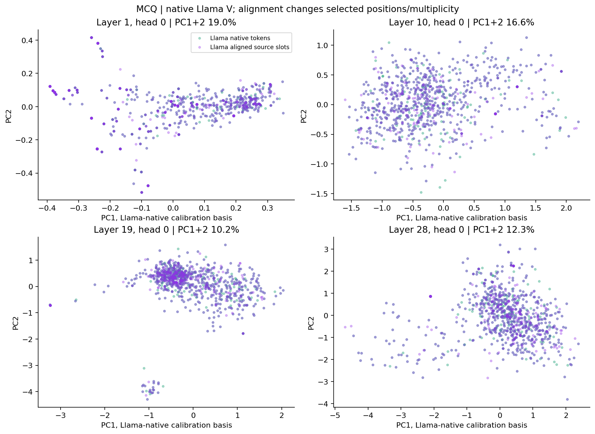
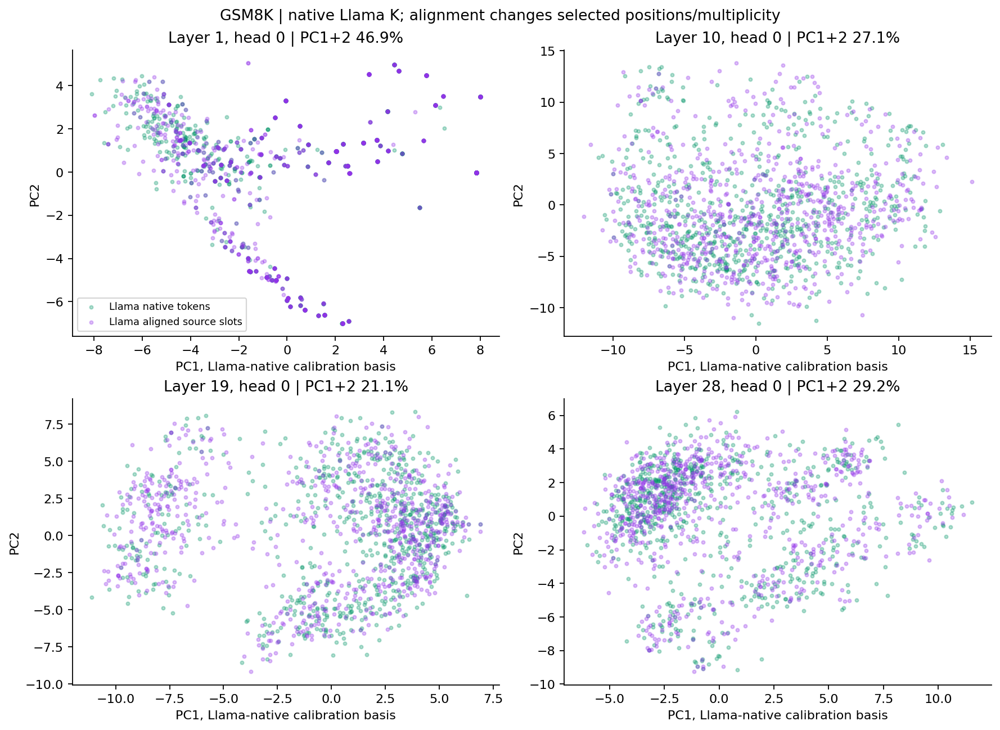
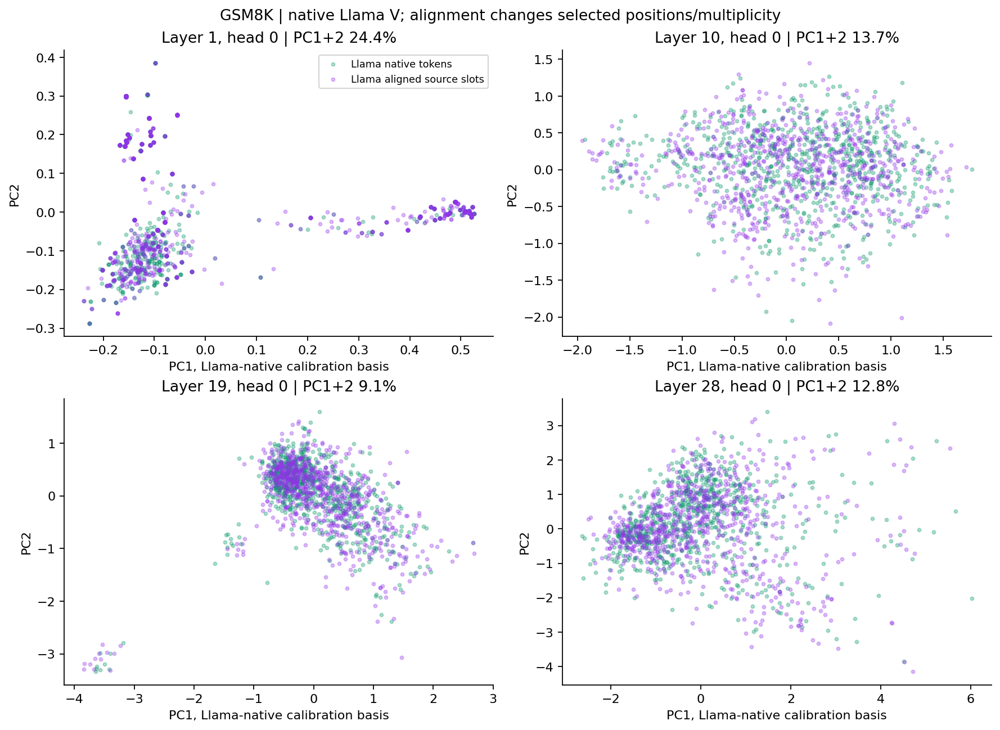

# Llama 原生 KV 的完整 PCA 分析

使用原 PCA 实验完全相同的96个 prompt 和校准/对照划分。Llama 为28层×8 KV heads，Qwen 为36层×8 KV heads，每个 head 都是128维。
Llama 保留原 writer 的 sender 编码，包括 BOS；K 是 RoPE 之前的原生 key，V 为原生 value。
Llama native：在相同外部文本区间内，按原生 token 位置不重复采样。Llama aligned：原 Full-Sync copy/drop 后、进入翻译器前的精确 source slots，包含重复位置。
各条件均基于各自对照样本的中心化协方差谱统计，不能把不同模型的 PCA 坐标方向直接对应。

| 分组 | KV | 条件 | 80% | 90% | 95% | 99% | 平均有效秩 |
|---|---|---|---:|---:|---:|---:|---:|
| mcq | K | Llama native tokens | 33 | 53 | 71 | 101 | 44.68 |
| mcq | K | Llama aligned source slots | 34 | 53 | 71 | 101 | 44.87 |
| mcq | K | Qwen native | 29 | 47 | 65 | 95 | 38.18 |
| mcq | K | Translated A+B | 13 | 20 | 28 | 51 | 17.70 |
| mcq | V | Llama native tokens | 57 | 81 | 98 | 120 | 77.43 |
| mcq | V | Llama aligned source slots | 57 | 81 | 98 | 120 | 77.65 |
| mcq | V | Qwen native | 57 | 81 | 99 | 120 | 72.34 |
| mcq | V | Translated A+B | 25 | 40 | 55 | 83 | 35.92 |
| gsm8k | K | Llama native tokens | 31 | 51 | 70 | 101 | 42.26 |
| gsm8k | K | Llama aligned source slots | 30 | 50 | 68 | 100 | 40.62 |
| gsm8k | K | Qwen native | 26 | 43 | 61 | 92 | 35.82 |
| gsm8k | K | Translated A+B | 13 | 21 | 30 | 53 | 18.89 |
| gsm8k | V | Llama native tokens | 56 | 80 | 98 | 120 | 75.55 |
| gsm8k | V | Llama aligned source slots | 54 | 78 | 97 | 119 | 72.39 |
| gsm8k | V | Qwen native | 55 | 79 | 98 | 120 | 73.13 |
| gsm8k | V | Translated A+B | 31 | 50 | 67 | 97 | 45.02 |

成分数为所有层/head 的所需数量中位数，向上取整；原始逐层逐 head 结果保留在 metrics。





## 对齐抽样检查

```json
{
  "mcq": {
    "calibration": {
      "prompts": 16,
      "native_sampled_tokens": 255,
      "aligned_sampled_slots": 255,
      "aligned_duplicate_slots": 0
    },
    "analysis": {
      "prompts": 48,
      "native_sampled_tokens": 760,
      "aligned_sampled_slots": 761,
      "aligned_duplicate_slots": 2
    }
  },
  "gsm8k": {
    "calibration": {
      "prompts": 8,
      "native_sampled_tokens": 256,
      "aligned_sampled_slots": 256,
      "aligned_duplicate_slots": 2
    },
    "analysis": {
      "prompts": 24,
      "native_sampled_tokens": 768,
      "aligned_sampled_slots": 768,
      "aligned_duplicate_slots": 4
    }
  }
}
```

## 二维投影，仅供观察









## 解释边界

- 本实验对比同一批文本，但原生分词点集和对齐后点集不同；字符边界采用重叠规则并逐样本记录。
- Llama 与 Qwen 层数不同、head 坐标不同；没有假定它们的同编号层/head 具有语义对应。
- 方差谱集中不等于语义信息丢失；仅凭源空间与目标空间维度不同也不能证明翻译器导致信息瓶颈。
- 对齐视图与已有翻译后统计使用精确相同的 target positions，便于检查 copy/drop 和 token 权重的影响。
- 没有重新评测任务准确率，没有训练接收方，也没有进行混合缓存实验。
