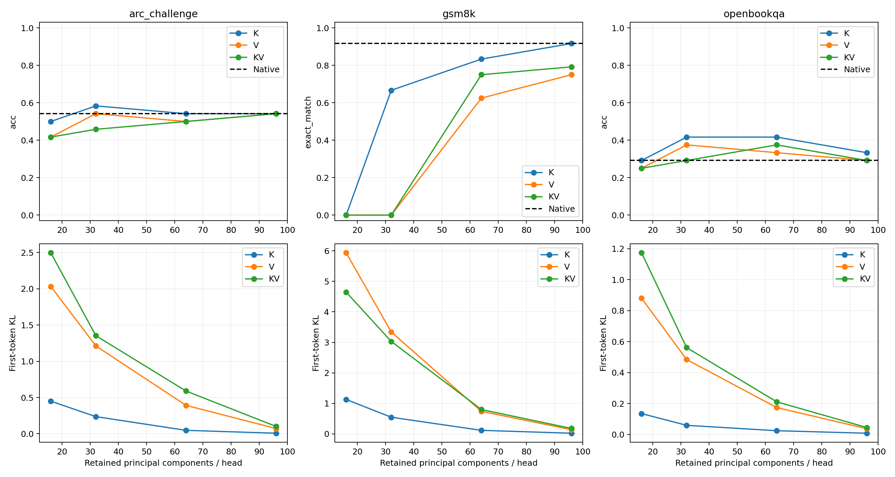

# Qwen 原生 KV PCA 压缩干预

服务器 B；沿用原 PCA 的校准/分析划分，每任务 24 条分析样本。
所有分数均重新评测；首 token KL 与完整生成评分分开。未训练模型，未删除 token，后续生成 KV 不压缩。

| 任务 | 条件 | 首 token KL | acc / strict EM | acc_norm / flexible EM |
|---|---|---:|---:|---:|
| arc_challenge | native | 0.00000 | 0.5417 | 0.5833 |
| arc_challenge | K_16 | 0.44940 | 0.5000 | 0.5417 |
| arc_challenge | V_16 | 2.03246 | 0.4167 | 0.5000 |
| arc_challenge | KV_16 | 2.49593 | 0.4167 | 0.5000 |
| arc_challenge | K_32 | 0.23636 | 0.5833 | 0.5417 |
| arc_challenge | V_32 | 1.21161 | 0.5417 | 0.5000 |
| arc_challenge | KV_32 | 1.35250 | 0.4583 | 0.5417 |
| arc_challenge | K_64 | 0.04733 | 0.5417 | 0.5833 |
| arc_challenge | V_64 | 0.39168 | 0.5000 | 0.5417 |
| arc_challenge | KV_64 | 0.58957 | 0.5000 | 0.5417 |
| arc_challenge | K_96 | 0.00740 | 0.5417 | 0.5833 |
| arc_challenge | V_96 | 0.07225 | 0.5417 | 0.5417 |
| arc_challenge | KV_96 | 0.10071 | 0.5417 | 0.5417 |
| gsm8k | native | 0.00000 | 0.9167 | 0.8750 |
| gsm8k | K_16 | 1.12800 | 0.0000 | 0.0000 |
| gsm8k | V_16 | 5.93386 | 0.0000 | 0.1250 |
| gsm8k | KV_16 | 4.64490 | 0.0000 | 0.0417 |
| gsm8k | K_32 | 0.54621 | 0.6667 | 0.7500 |
| gsm8k | V_32 | 3.33974 | 0.0000 | 0.4167 |
| gsm8k | KV_32 | 3.02943 | 0.0000 | 0.2083 |
| gsm8k | K_64 | 0.11647 | 0.8333 | 0.8333 |
| gsm8k | V_64 | 0.73893 | 0.6250 | 0.7083 |
| gsm8k | KV_64 | 0.79819 | 0.7500 | 0.7917 |
| gsm8k | K_96 | 0.02163 | 0.9167 | 0.8333 |
| gsm8k | V_96 | 0.13725 | 0.7500 | 0.7500 |
| gsm8k | KV_96 | 0.17834 | 0.7917 | 0.7500 |
| openbookqa | native | 0.00000 | 0.2917 | 0.4167 |
| openbookqa | K_16 | 0.13511 | 0.2917 | 0.3750 |
| openbookqa | V_16 | 0.87967 | 0.2500 | 0.3333 |
| openbookqa | KV_16 | 1.17282 | 0.2500 | 0.2917 |
| openbookqa | K_32 | 0.05931 | 0.4167 | 0.3750 |
| openbookqa | V_32 | 0.48395 | 0.3750 | 0.2917 |
| openbookqa | KV_32 | 0.56080 | 0.2917 | 0.3333 |
| openbookqa | K_64 | 0.02453 | 0.4167 | 0.4583 |
| openbookqa | V_64 | 0.17383 | 0.3333 | 0.4167 |
| openbookqa | KV_64 | 0.21096 | 0.3750 | 0.3750 |
| openbookqa | K_96 | 0.00827 | 0.3333 | 0.4167 |
| openbookqa | V_96 | 0.03739 | 0.2917 | 0.4167 |
| openbookqa | KV_96 | 0.04505 | 0.2917 | 0.4167 |

本实验只检验在原生 PCA 方向上丢弃尾部成分的影响；不能仅凭相同 k 将它等同于翻译器的频谱、方向或误差。
保留方差为相对校准均值的能量；不等于语义保留率。谱的计算说明见 README。
