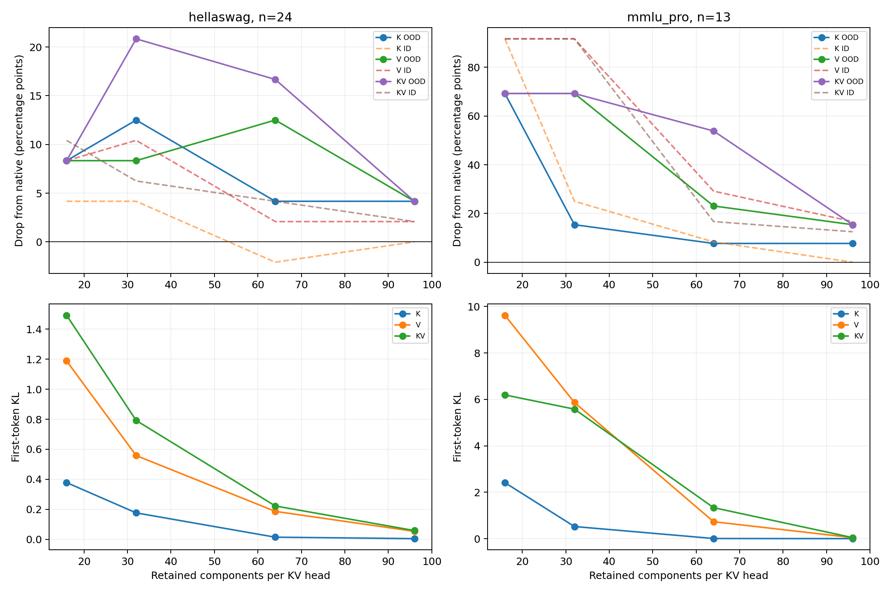

> 用户于北京时间2026-10-15 14:28要求完成第13条后跳过最后一条。本报告使用HellaSwag24条、MMLU-Pro13条，共37条；第14条psychology的2个已完成条件单独保存在excluded_partial，不计分。原始config/manifest保留；范围变更记录在user_stop_request.json。

# 冻结原生 PCA 基：OOD 压缩对照

服务器 B；全部分数重新评测；不在 OOD 上拟合或选择 PCA 基。
HellaSwag 使用 MCQ 基，MMLU-Pro 使用 GSM8K 基。MMLU-Pro2048 token，ID GSM8K256 token；格式与长度差异是解释限制。

| 数据集 | 条件 | 分数 | 相对原生下降 pp | ID下降 pp | 首token KL |
|---|---|---:|---:|---:|---:|
| hellaswag | native | 0.5417 | 0.00 | 0.00 | 0.0000 |
| hellaswag | K_16 | 0.4583 | 8.33 | 4.17 | 0.3780 |
| hellaswag | V_16 | 0.4583 | 8.33 | 8.33 | 1.1887 |
| hellaswag | KV_16 | 0.4583 | 8.33 | 10.42 | 1.4929 |
| hellaswag | K_32 | 0.4167 | 12.50 | 4.17 | 0.1761 |
| hellaswag | V_32 | 0.4583 | 8.33 | 10.42 | 0.5582 |
| hellaswag | KV_32 | 0.3333 | 20.83 | 6.25 | 0.7921 |
| hellaswag | K_64 | 0.5000 | 4.17 | -2.08 | 0.0141 |
| hellaswag | V_64 | 0.4167 | 12.50 | 2.08 | 0.1861 |
| hellaswag | KV_64 | 0.3750 | 16.67 | 4.17 | 0.2223 |
| hellaswag | K_96 | 0.5000 | 4.17 | 0.00 | 0.0045 |
| hellaswag | V_96 | 0.5000 | 4.17 | 2.08 | 0.0531 |
| hellaswag | KV_96 | 0.5000 | 4.17 | 2.08 | 0.0583 |
| mmlu_pro | native | 0.6923 | 0.00 | 0.00 | 0.0000 |
| mmlu_pro | K_16 | 0.0000 | 69.23 | 91.67 | 2.4142 |
| mmlu_pro | V_16 | 0.0000 | 69.23 | 91.67 | 9.6225 |
| mmlu_pro | KV_16 | 0.0000 | 69.23 | 91.67 | 6.1914 |
| mmlu_pro | K_32 | 0.5385 | 15.38 | 25.00 | 0.5243 |
| mmlu_pro | V_32 | 0.0000 | 69.23 | 91.67 | 5.8644 |
| mmlu_pro | KV_32 | 0.0000 | 69.23 | 91.67 | 5.5801 |
| mmlu_pro | K_64 | 0.6154 | 7.69 | 8.33 | 0.0087 |
| mmlu_pro | V_64 | 0.4615 | 23.08 | 29.17 | 0.7318 |
| mmlu_pro | KV_64 | 0.1538 | 53.85 | 16.67 | 1.3371 |
| mmlu_pro | K_96 | 0.6154 | 7.69 | 0.00 | 0.0029 |
| mmlu_pro | V_96 | 0.5385 | 15.38 | 16.67 | 0.0456 |
| mmlu_pro | KV_96 | 0.5385 | 15.38 | 12.50 | 0.0465 |

## 解释范围

- OOD 指偏离校准任务分布，不代表模型预训练未见。
- 先比较各数据集内压缩相对原生的下降，不用 OOD 原始得分更低证明压缩更敏感。
- 每学科仅一题；置信区间及逐样本输出见 summary/per_sample，不能视为完整 benchmark。
- MMLU-Pro 与 GSM8K 的预算、答案格式、上下文长度和任务难度不同，跨任务下降差异不能全部归因于 OOD。
- 相同 k 的保留能量可能因数据集而异；报告实际能量，不将低秩自动等同于信息丢失。
