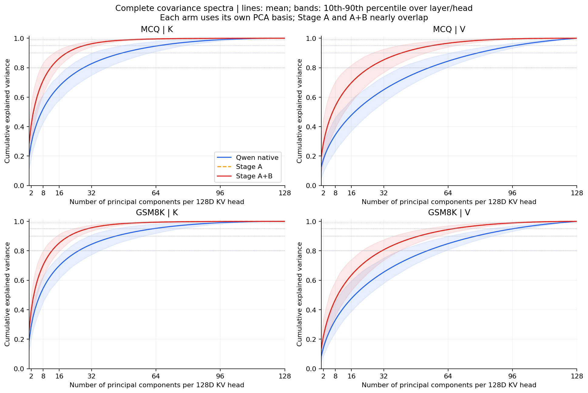
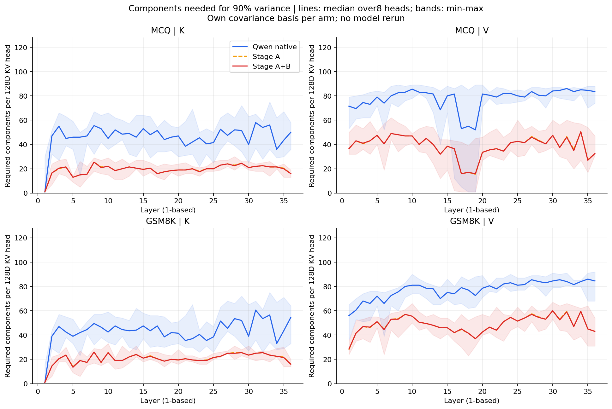
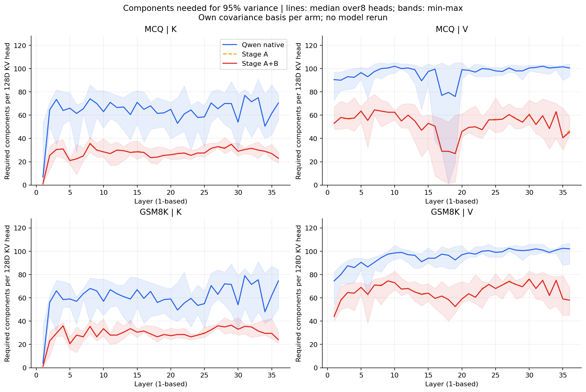

# 完整方差谱：解释 KV 需要多少个主成分

使用已完成实验保存的完整 128 维协方差谱，无需重跑模型。
每一层、每一个 KV head 的 K/V 分开计算：从最大特征值开始累加，第一次达到目标方差比例的成分数即为所需数量。
下表是 36 层 × 8 KV head 共 288 个组合的所需数量中位数，向上取整。每个 head 原始维度为 128。

各组用各自对照样本的中心化协方差谱，回答自身方差集中在多少方向；不表示翻译 KV 与原生 KV 使用相同方向。
原始二维图使用原生校准集的坐标和解释方差比例；这里使用对照样本自身完整谱，统计口径不同。

| 任务组 | KV | 条件 | 80% 方差 | 90% 方差 | 95% 方差 | 99% 方差 |
|---|---|---|---:|---:|---:|---:|
| mcq | K | Qwen 原生 | 29 | 47 | 65 | 95 |
| mcq | K | Stage-A | 13 | 20 | 28 | 51 |
| mcq | K | Stage-A+B | 13 | 20 | 28 | 51 |
| mcq | V | Qwen 原生 | 57 | 81 | 99 | 120 |
| mcq | V | Stage-A | 25 | 40 | 55 | 83 |
| mcq | V | Stage-A+B | 25 | 40 | 55 | 83 |
| gsm8k | K | Qwen 原生 | 26 | 43 | 61 | 92 |
| gsm8k | K | Stage-A | 13 | 21 | 30 | 53 |
| gsm8k | K | Stage-A+B | 13 | 21 | 30 | 53 |
| gsm8k | V | Qwen 原生 | 55 | 79 | 98 | 120 |
| gsm8k | V | Stage-A | 32 | 50 | 67 | 97 |
| gsm8k | V | Stage-A+B | 31 | 50 | 67 | 97 |

## 层和 head 的差异

以下是达到 95% 方差所需成分数的第 10–90 百分位范围（向外取整），用于展示异质性，不是置信区间。

| 组 | KV | 条件 | P10–P90 | 全部 head 均达到 95% 所需上限 |
|---|---|---|---:|---:|
| mcq | K | Qwen 原生 | 47–79 | 91 |
| mcq | K | Stage-A+B | 22–35 | 41 |
| mcq | V | Qwen 原生 | 87–103 | 105 |
| mcq | V | Stage-A+B | 40–68 | 78 |
| gsm8k | K | Qwen 原生 | 44–77 | 91 |
| gsm8k | K | Stage-A+B | 23–37 | 43 |
| gsm8k | V | Qwen 原生 | 85–103 | 107 |
| gsm8k | V | Stage-A+B | 53–76 | 83 |

## 对结果的解释

- 原生 V 的 95% 方差通常需要约 98–99 个成分，99% 方差约需 120 个，明显不能用二维或三维充分概括。
- 原生 K 达到 90% 方差的典型数量约 43–47，翻译后约 20–21；翻译后的方差更集中。
- Stage-A 与 Stage-A+B 所需数量非常接近，Stage-B 没有明显恢复原生的方差谱形状。
- 这是方差集中程度的证据；不能直接证明丢失了多少语义、低方差方向不重要，或压缩后任务效果会保持。
- 这些数量针对每个 head 的 128 维空间，不是整个模型跨层跨 head 联合表示的维度。

## 图表

[完整统计](summary.json) · [每层每个 head 的精确数量](per_layer_head.json) · [计算脚本](analyze_variance.py)
