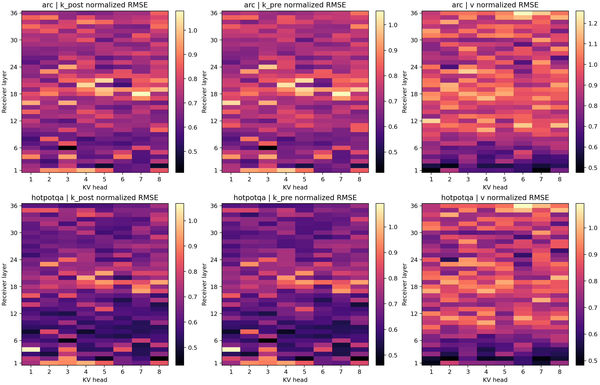
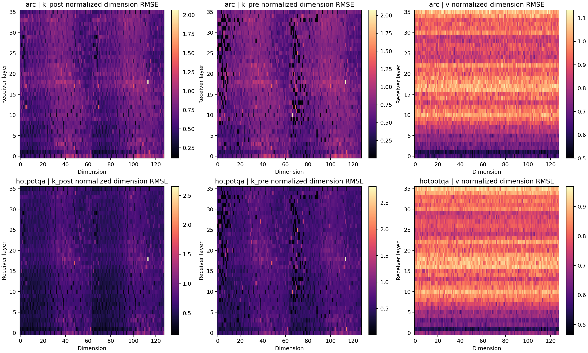

# Fine-grained KV error and functional sensitivity: C, ARC32+Hotpot32

| Task | Context | Q | Predictor | Correlation with Attention JS | Correlation with Head post-Wo error |
|---|---|---|---|---:|---:|
|arc|gold_answer|native_q|relative_l2|0.232|0.089|
|arc|gold_answer|native_q|mean_abs_coordinate_contribution|0.266|0.087|
|arc|gold_answer|native_q|logit_rmse|0.404|0.123|
|arc|gold_answer|native_q|native_weighted_logit_variance|0.759|0.365|
|arc|gold_answer|translated_q|relative_l2|0.225|0.104|
|arc|gold_answer|translated_q|mean_abs_coordinate_contribution|0.310|0.132|
|arc|gold_answer|translated_q|logit_rmse|0.390|0.125|
|arc|gold_answer|translated_q|native_weighted_logit_variance|0.739|0.385|
|arc|student_prefix|native_q|relative_l2|0.233|0.080|
|arc|student_prefix|native_q|mean_abs_coordinate_contribution|0.342|0.179|
|arc|student_prefix|native_q|logit_rmse|0.419|0.168|
|arc|student_prefix|native_q|native_weighted_logit_variance|0.814|0.512|
|arc|student_prefix|translated_q|relative_l2|0.233|0.087|
|arc|student_prefix|translated_q|mean_abs_coordinate_contribution|0.334|0.168|
|arc|student_prefix|translated_q|logit_rmse|0.437|0.184|
|arc|student_prefix|translated_q|native_weighted_logit_variance|0.808|0.515|
|hotpotqa|gold_answer|native_q|relative_l2|0.260|0.092|
|hotpotqa|gold_answer|native_q|mean_abs_coordinate_contribution|0.391|0.141|
|hotpotqa|gold_answer|native_q|logit_rmse|0.454|0.190|
|hotpotqa|gold_answer|native_q|native_weighted_logit_variance|0.643|0.284|
|hotpotqa|gold_answer|translated_q|relative_l2|0.277|0.108|
|hotpotqa|gold_answer|translated_q|mean_abs_coordinate_contribution|0.421|0.163|
|hotpotqa|gold_answer|translated_q|logit_rmse|0.448|0.225|
|hotpotqa|gold_answer|translated_q|native_weighted_logit_variance|0.622|0.302|
|hotpotqa|student_prefix|native_q|relative_l2|0.285|0.096|
|hotpotqa|student_prefix|native_q|mean_abs_coordinate_contribution|0.404|0.145|
|hotpotqa|student_prefix|native_q|logit_rmse|0.454|0.203|
|hotpotqa|student_prefix|native_q|native_weighted_logit_variance|0.648|0.297|
|hotpotqa|student_prefix|translated_q|relative_l2|0.295|0.088|
|hotpotqa|student_prefix|translated_q|mean_abs_coordinate_contribution|0.418|0.132|
|hotpotqa|student_prefix|translated_q|logit_rmse|0.447|0.206|
|hotpotqa|student_prefix|translated_q|native_weighted_logit_variance|0.630|0.292|

All token/head/coordinate error marginals and contribution summaries are in error_stats/*.npz (derived statistics only). Selected critical-token signed error/contribution vectors are included; full native/translated KV and full dense contribution tensors are not stored.

- Only experiments1/2: frozen C(Attention-R64), Llama3.2-3B→Qwen3-4B, original first32 ARC and first32 Hotpot questions. All36 layers/8KV heads/body tokens/128 dimensions computed. No new translator, dimension repair, random control, A/D sweep, MMLU-Pro or independent128-question confirmation.
- Post-k_norm/post-RoPE K errors are the primary functional coordinates. A supplementary inverse-RoPE atlas remains post-k_norm and must not be called pre-normalization translator error. V has no RoPE. Token grids and public header are unchanged.
- Native RMS normalization is per question/layer/KVhead/dimension across ALL body tokens, floored at max(5% of head RMS,1e-6). Store raw MAE/RMSE/signed bias, normalized metrics and floor fractions. Per-token/head and per-coordinate/head marginals are kept; they cannot reconstruct the entire joint error tensor.
- Q_native and Q_C are captured from real receiver forwards under the same shared gold-answer context or the same immutable C-generated prefix from Phase1. Each Q is held fixed while comparing native and translated body states; native-Q and translated-Q references hold their own nonbody tail fixed. Gold context uses all gold probes; C-prefix context reuses at most8 positions from up to64 actual generated tokens.
- Every Query head is matched to its actual shared KV head:32Q/8KV=4 associated queries per KV head. Signed coordinate C=q_post*deltaK_post*actual attention scaling. Contributions are NOT logits after softcap; assert this Qwen has no attention-logit softcap.
- Sum of128 signed contributions must equal the attention-logit delta. Coordinate contributions can cancel; record delta-logit RMS, cancellation ratio, native-attention-weighted centered logit variance, Attention JS/KL and four local K/V post-Wo readouts. These are offline operator counterfactuals, not new whole-model repair interventions.
- Mean absolute coordinate contribution factorizes exactly into mean abs Query times mean abs error. Its improvement over numerical error alone is not a causal mechanism. Signed sums, cancellation, Softmax and output readouts remain necessary.
- RoPE pairs are(d,d+64). Paired signed contributions are invariant under a common key-coordinate change; individual coordinate rankings need not be. Store pair mean absolute signed contribution, paired error RMS and top4/top8 pair overlap(8/16 scalar dimensions), but do not use these selections for repair or deployability claims.
- Per-question compressed NPZ files contain DERIVED error marginals, coordinate/pair contribution statistics and selected critical-token signed arrays, not native/translated KV, raw Query tensors or weights. Full H×P×T×D contributions are never allocated. Stream probe/token chunks and discard per-layer temporaries.
- Figures use fixed examples0/16 per task, layers3/21/27, KV heads1/5 and fixed-stride token plots. Additional saved critical tokens are the union of fixed-stride, high-error, high-logit-change and Native-attention peaks; this is explicitly Oracle diagnostic selection, not a learned/deployable dimension policy.
- Compare numerical and functional predictors using32-question cluster bootstrap500 times, ranking across questions separately within each layer/KV-head cell. Heads/tokens/dimensions are not independent experimental subjects. Constant/undefined correlations remain undefined.
- All samples were used previously in exploratory evaluations. These results cannot establish final-answer causality or substitute for dimension interventions/independent validation. Later confirmation must exclude all previously inspected ARC128/Hotpot512 and calibration IDs, not simply reuse the unselected remainder.
- All36 Gold/NativeQ routeKL values must agree with the prior full-map experiment within1e-5. Smoke checks exact GQA coordinate-sum identity, RoPE roundtrip/pair invariance, fixed-query output reconstruction and representative/long-body memory before full evaluation.
- All older Transformer/fusion training stays paused. Detached fail-stop pipeline and resumable per-sample outputs. No automatic upload, repeated monitoring or automatic experiment3/algorithm training.
