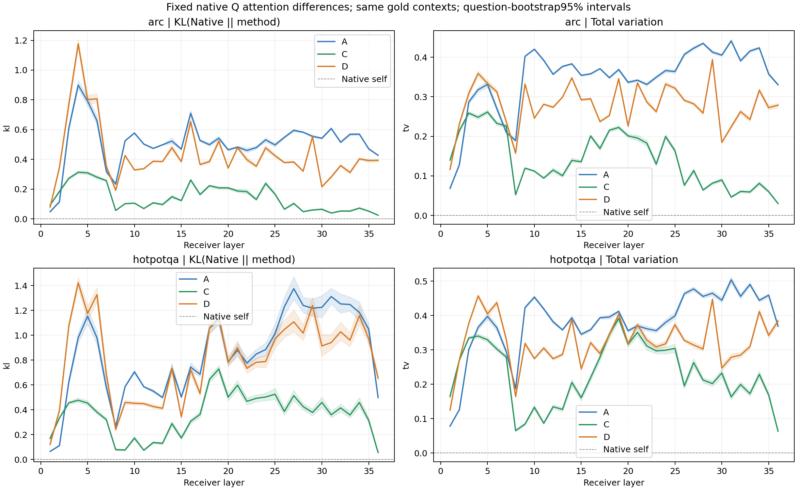
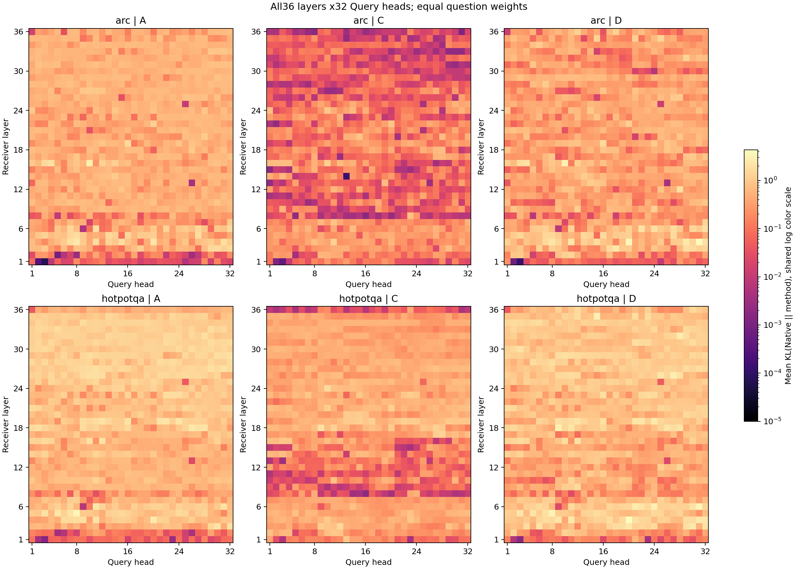
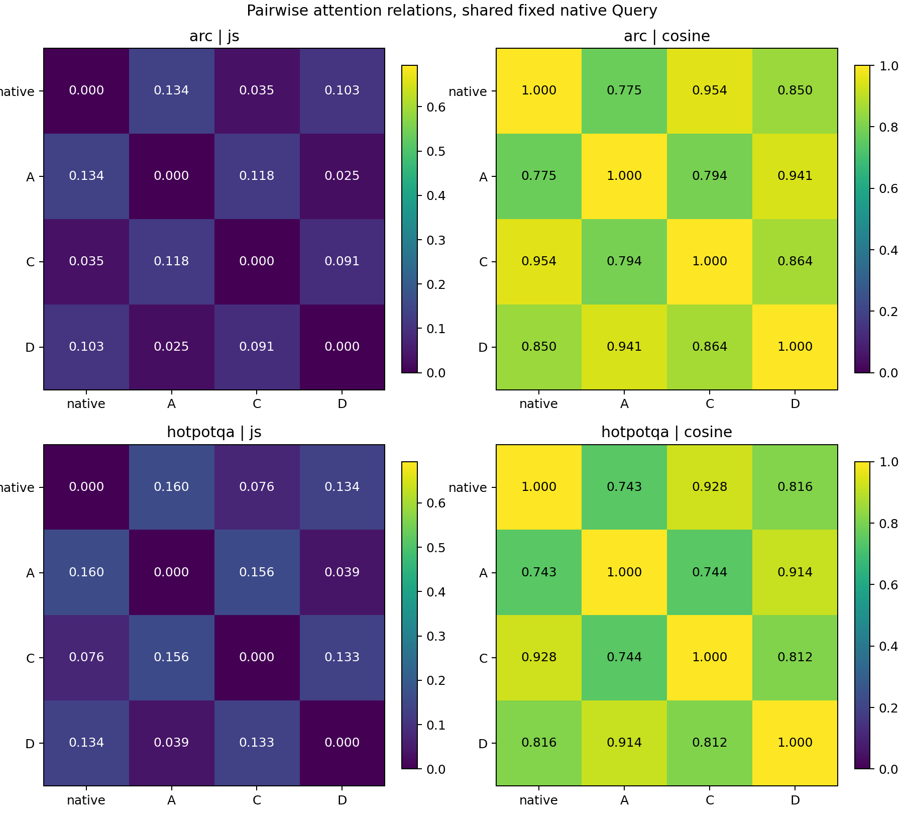

# A/C/D vs Qwen attention maps: fixed native Query

| Task | Method | Mean KL(Native || method) | JS | TV | Cosine | Body top10 overlap | Historical task score |
|---|---|---:|---:|---:|---:|---:|---:|
|arc|A|0.5114|0.1338|0.3462|0.7753|0.6142|65.62%|
|arc|C|0.1421|0.0351|0.1415|0.9542|0.6292|65.62%|
|arc|D|0.4343|0.1030|0.2786|0.8502|0.5907|64.06%|
|hotpotqa|A|0.8490|0.1601|0.3803|0.7431|0.5467|31.64%|
|hotpotqa|C|0.3606|0.0757|0.2285|0.9281|0.5508|43.86%|
|hotpotqa|D|0.8104|0.1340|0.3245|0.8164|0.5053|29.42%|

Historical task score = ARC accuracy or Hotpot answer F1 on the same64 questions; not a new evaluation.

Examples use fixed row indices0 and32, layers3/21/27. Token plots use the same union-of-top8 columns and shared probability scale per layer across all4 methods. Body-bin plots sum original probability mass, never renormalize selected tokens.

- User selected fixed-Q attention-map relationships only. No new actual-Q comparison or K/V four-condition functional rerun. Existing Phase1 actual-Q/functional analyses remain separate.
- Same ARC64 and HotpotQA64 IDs/order and frozen A/C/D/Recolor/LLMs. All36 Receiver layers and32 Query heads are compared; these are Query heads, not independent KV heads in GQA(8KV,4queries perKV). No new datasets or training.
- Within each question all4 sources use exactly the same Native Query, gold prefix, positions, causal mask and native nonbody(header+continuation) keys. Only body K changes. Attention probabilities depend on Q/K, not directly on V; V/output mechanisms belong to the preceding experiment.
- Gold context includes every literal gold-answer prediction position, same tokens for all4 methods. Fixed Native Query is an offline diagnostic, not a deployable student feature or a comparison of each method independently generated sequences.
- Native attention is a reference distribution, not ground-truth evidence attribution. Closer attention alone does not imply higher accuracy. Native can answer incorrectly and is not superior on every question.
- All18 overlapping layer metrics must reproduce Phase1 fixed-Native-Q gold-context routeKL within1e-5. Native self distances must be zero, shared header/tail and body source positions are tensor-checked in smoke. Native token grid and cache RoPE conventions are unchanged.
- Question is the statistical unit: average heads and gold probes within question; aggregate equal question weights and bootstrap64 complete questions1000 times. Head/probe/token counts never inflate sample size. Figures use the same scales across methods.
- Per-question JSON stores per-layer/head KL/JS/TV/cosine/top10 overlap, full pairwise method relationships, attention-error residual alignment, and attention mass over header/body/continuation and textual question/choice/passage regions. Region labels are structural, not gold supporting facts.
- Plot examples use immutable indices0 and32 in each task, layers3/21/27, without filtering on correctness or effect size. Token columns are a symmetric union of top8 body positions per method; this selection affects pictures only, not full-grid metrics. No probability renormalization after selecting tokens.
- Body-bin pictures sum original probability mass into64 relative-position bins per head, averaged across gold probes. This is a visualization compression, not a full probability tensor and not a semantic token alignment across different questions.
- Head-layer KL plots share a log color scale with floor1e-5 for visualization only; raw zero distances remain zero in JSON. Token panels share the same raw probability scale per layer; no per-method contrast enhancement.
- Only compact attention-map summaries(example token/bin arrays), PNG/SVG figures and JSON diagnostics are persisted. No model weights, KV, full Query tensors or full T-by-T attention matrices are saved.
- Background queue waits for prior mechanism experiment successful completion and GPU release. Dependency failure stops queue; errors stop evaluation. Transformer and fusion stay paused. No automatic upload, new architecture, follow-up training or ongoing notifications.
